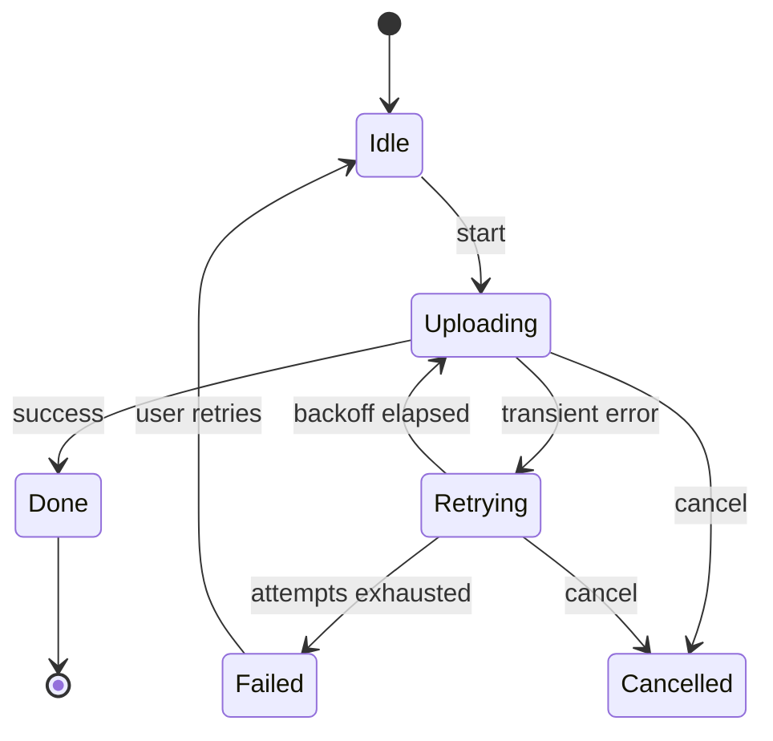

# Ask for the state machine

One of the cheapest, highest-value things you can ask a coding agent for is a **finite
state machine (FSM) of the thing you are building or debugging**: its states, the events
that move it between them, and what happens for every state/event pair.

It works because it changes the question. "Does this code work?" invites the agent to
check the paths it already thought of. "What does the system do in *every* state, for
*every* event?" is a finite list, and the agent has to fill in each cell. The empty cells
are your edge cases, found before a user finds them.

## Why it pays off

- **Edge cases show up as blank cells.** A table of 5 states × 6 events has 30 cells.
  Most bugs live in the cells nobody wrote down: "cancel while uploading", "timeout
  after already succeeding", "retry while the retry is still running".
- **Impossible states become visible.** Code that keeps state in several booleans
  (`isLoading`, `hasError`, `isDone`) allows combinations nobody meant, such as loading
  *and* done. A single explicit state can't be two things at once.
- **It is a shared vocabulary.** Once the agent has named the states, you and the agent
  can talk precisely: "in `Draining`, a `Shutdown` event should be ignored, not queued."
  Later sessions read the same names.
- **It tests understanding, both ways.** If the agent cannot draw the machine, it does not
  understand the problem yet, and you have learned that before it wrote 400 lines. If
  *you* look at the diagram and say "that state doesn't exist" or "there's a state missing",
  you have corrected the agent's model of the domain in one sentence.
- **It is reviewable.** A diagram and a table are much faster to check than a diff.
  Reviewing the model first means the code review is about whether the code matches it.

## When to ask for one

Anything with a lifecycle or a protocol: connections and sessions, retries and backoff,
uploads and jobs, payments and orders, auth flows, device power and sleep/wake, UI flows
with loading/error/empty states, parsers, sync between two copies of data, and anything
where "it worked, then it got into a weird state" is the bug report.

It is also a strong first move when **debugging** such a system: ask for the machine as
the code actually implements it (not as intended), then compare the two.

## State machines are everywhere

You don't need to write software for this way of thinking to pay off. Much of the
everyday world is made of state machines, and many everyday frustrations are an
unhandled cell. Once you see them, you start predicting where things will break.

| everyday system | states | the cell that bites |
|---|---|---|
| **Turnstile** (the textbook example) | locked, unlocked | someone pushes while locked: the bar holds, nothing else happens |
| **Traffic light** | green, yellow, red, flashing (fault) | a power cut: lights go dark, or to all-way flashing red. In many places the law treats a dark signal as an all-way stop: a fallback state written into the rules of the road |
| **Elevator** | idle, moving up, moving down, doors open, out of service | pressing the call button again does nothing (it's already latched). People press it again anyway, because the button doesn't show that state clearly |
| **Thermostat** | heating, idle, cooling | without *hysteresis* (a gap between "turn on" and "turn off" temperatures), it flips on and off every few seconds. The fix is extra states, not a better sensor |
| **Microwave** | idle, running, paused (door open), done | open the door mid-cook, close it: should it resume? Different brands answer differently, which is why you're never sure |
| **Washing machine** | fill, wash, drain, spin, done, door locked | why the door stays locked for a minute after the cycle ends: there is a "draining/unlocking" state you can't see |
| **Parcel delivery** | label created, in transit, out for delivery, delivered, exception, returned | "delivered" to a neighbour's door is the same state as delivered to yours. The model has no state for "delivered to the wrong place" |
| **A flight** | scheduled, boarding, departed, delayed, cancelled, diverted | delayed, then cancelled, then un-cancelled. Rebooking systems that never planned for the third step strand people |
| **Library book** | on shelf, on hold, checked out, overdue, lost, in repair | returned *after* being marked lost and billed. Every library has had to decide that cell |
| **Job application** | applied, screening, interviewing, offer, rejected, withdrawn, ghosted | "ghosted" is a real state the process never names. A timeout transition would fix it |
| **A conversation with customer support** | new, assigned, waiting on you, waiting on them, escalated, resolved, reopened | you reply after the ticket auto-closes. Does it reopen, or start a new ticket and lose the history? |

Try it on something that frustrates you: list its states, list the events, and find the
cell. Explaining *why* a system behaves badly ("they never handled 'cancelled after
boarding'") is the first step to fixing it, or to working around it.

Agents are good at this. "Model the process of renewing a passport as a state machine,
and list the edge cases that trip people up" is a fine prompt, and it teaches you the
process faster than reading the official guide.

## How to ask

Paste something like this:

> Before changing any code, model this as a finite state machine.
>
> 1. List every state, with one line on what is true in it. Include error, cancelled,
>    timed-out and partially-done states if they exist.
> 2. List every event: user actions, timers, network responses, process restarts,
>    and failures of each dependency.
> 3. Give a transition table with **every** state × event pair. For each cell write the
>    next state and the action, or "ignored (why)", or "impossible (why it cannot
>    happen)". Do not leave cells out.
> 4. Draw it as a Mermaid `stateDiagram-v2`.
> 5. List the cells the current code does not handle, or handles differently from the
>    table, with file and line.
> 6. List the questions you can't answer from the code. Those are mine to decide.

Then **read the table yourself**. The value is in the disagreements: a cell where your
intent and the agent's model differ is a bug, a missing requirement, or a misunderstanding,
and it costs nothing to fix at this point.

A small example of what you get back:

| state \ event | start | success | transient error | cancel |
|---|---|---|---|---|
| Idle | → Uploading | impossible (nothing in flight) | impossible | ignored |
| Uploading | ignored (already running) | → Done | → Retrying | → Cancelled, abort request |
| Retrying | ignored | **late response: ?** | impossible | → Cancelled, clear timer |
| Done | ? | ignored (duplicate) | ignored | ignored |

The bold cell is the kind of thing this finds: a response from the *previous* attempt
arriving while the machine is waiting to retry. Is it a success? Should the retry timer be
cancelled? Without the table, nobody asks until it happens in production.

## From the model to the code

- **One explicit state value**, not a cluster of booleans: an enum or tagged union
  (`enum`, `sealed class`, a TypeScript discriminated union), with **exhaustive matching**
  so the compiler flags a state or event nobody handled.
- **Keep the diagram in the repo** (Mermaid renders on GitHub) next to the code it
  describes, and ask the agent to update it in the same PR as any change to the
  transitions. A stale diagram is worse than none.
- **Test the transitions, not just the happy path.** The table *is* a test list: one case
  per cell, including "ignored" and "impossible" (assert they are). For more coverage,
  use **stateful / model-based property testing**, where the tool generates random event
  sequences and checks the code against a simple model: Hypothesis `RuleBasedStateMachine`
  (Python), fast-check model-based testing (JS/TS), `proptest-state-machine` (Rust),
  jqwik (Java). These find the five-step sequences no one would write by hand.
- **Use a library when the machine is central and large.** Prior art applies here too
  (see [PRIOR-ART-AND-SKILLS.md](PRIOR-ART-AND-SKILLS.md)): XState / statecharts for
  JS/TS UIs and workflows, and the state-machine features of your workflow engine or
  framework, before hand-rolling a dispatcher. For a small machine, an enum and a `match`
  are enough.

## A real example

A power manager put an idle machine to sleep and woke it on demand. It treated "doesn't
answer ping" as "off". Nobody had written down a state for **powered on and running, but
with no network link**. Then someone unplugged the machine's network cable. The wake
script saw "off", decided the machine was stuck before booting, and cut and restored its
power. It did this three times, to a machine that was running normally the whole time.

An FSM would have shown it at once. "Unreachable" was one state standing in for three
(off, booting, running without a network link), and the "power-cycle" action was
attached to all three. The fix was to read two separate signals: power draw at the
outlet for *powered*, and the switch port for *link*. Then each real state got its own
transitions, and a running machine is never power-cycled.

## The rule (paste into your global CLAUDE.md)

> **Model stateful things as state machines.** Before building or changing anything with a
> lifecycle, protocol, retries, or sleep/wake, and before debugging "it got into a weird
> state", write the finite state machine: states, events, and a transition table covering
> every state × event pair (next state and action, or "ignored"/"impossible" with a
> reason), plus a Mermaid diagram. List unhandled cells and open questions for me. Prefer
> one explicit state value with exhaustive matching over sets of booleans. Keep the
> diagram in the repo and update it with the code.
